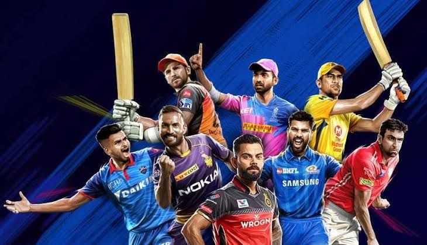

# 🏏 IPL Analytics & Intelligence Platform (2008–2026)

<p align="center">
  
</p>

<p align="center">
  <a href="https://www.python.org/downloads/"></a>
  <a href="https://streamlit.io/"></a>
  <a href="https://plotly.com/"></a>
  <a href="https://www.kaggle.com/datasets/te1234567/ipl-player-images-dataset-20082026/data"></a>
  <a href="https://opensource.org/licenses/MIT"></a>
</p>

A premier cricket data analytics, historical archiving, and machine learning intelligence platform covering all **19 seasons (2008–2026)** of the Indian Premier League.

---

## 🌐 Official Kaggle Dataset

> 🌟 **Authored & Curated by Tejas Ingle on Kaggle:**  
> 🔗 **[IPL Player Images Dataset (2008–2026) on Kaggle](https://www.kaggle.com/datasets/te1234567/ipl-player-images-dataset-20082026/data)**  
> 
> This platform is powered by the custom **IPL Player Images Dataset**, created and maintained by **Tejas Ingle**. The dataset features 420+ high-resolution, authenticated player headshots and jersey action shots organized across every franchise from 2008 to 2026. Specially curated for computer vision, sports analytics, and custom FIFA 26-style trading cards.

---

## 🌟 Key Platform Features

### 1. 📊 14 Comprehensive Analytics Modules
- **Overview & Season Analysis**: Multi-season trajectory, run rates, boundary counts, wicket falls, and championship dynasty cards.
- **Team Intelligence**: Head-to-head records, win percentages batting first vs chasing, and franchise dominance.
- **Player Leaderboards**: Real-time Orange Cap (run-scorers) and Purple Cap (wicket-takers) visual distributions.
- **Venue & Stadium Dynamics**: Scoring trends, toss impact, and boundary statistics across major Indian and overseas venues.
- **Phase Breakdown**: Powerplay (overs 1–6), Middle (overs 7–15), and Death overs (overs 16–20) run-rate and wicket-loss analytics.
- **All-Time Records & Hall of Fame**: Top 50 Greatest IPL Players ranking and handpicked All-Time Legendary Playing XI.

### 2. 🃏 FIFA 26 Ultimate Player Profile & Career Dossier
- Custom card generation across four distinct rarity tiers:
  - ⚪ **Standard Edition** (Rising talents & squad players)
  - 🟡 **Rare Edition** (Established match-winners)
  - 🟣 **Epic Edition** (Tournament icons & overseas superstars)
  - 👑 **Icon Edition** (All-time legends: Kohli, Rohit, Dhoni, Bumrah, Gayle, De Villiers)
- Curated face graphics featuring authentic franchise jerseys from the official Kaggle dataset.
- Dynamic interactive flip cards pairing FIFA rating attributes with full career batting & bowling metrics.

### 3. 🔍 Typo-Tolerant Fuzzy Player Search
- Multi-tier fuzzy matching algorithm powered by token sequence matching and marquee player prioritization.
- Seamlessly resolves misspellings, partial surnames, and typos (e.g. `virat kholi` $\rightarrow$ `Virat Kohli`, `sharama` $\rightarrow$ `Rohit Sharma`, `bumra` $\rightarrow$ `Jasprit Bumrah`, `flintof` $\rightarrow$ `Andrew Flintoff`, `dhony` $\rightarrow$ `MS Dhoni`).
- Auto-selects the #1 closest match immediately without players disappearing from the view.

### 4. 🏛️ IPL Iconic Moments Archive (2008–2026)
- **81 Authenticated Moments**: Covering every single season from 2008 to 2026 without gaps.
- Complete sports journalism historical narratives, why each moment made history, match scorelines, and verified links to:
  - 📺 Official Broadcast Highlights & Video
  - 📊 ESPNcricinfo Full Scorecards
  - 📰 Official Match Reports
- **Top 50 Greatest IPL Moments**: Ranked with deep historical justifications.
- Structured JSON database available at [`ipl_iconic_moments_2008_2026.json`](./ipl_iconic_moments_2008_2026.json).

### 5. 🖼️ Visual League Gallery
- Responsive, dark-themed image gallery housing 57 high-resolution player wallpapers, celebrations, and franchise moments with smooth zoom animations.

---

## 🛠️ Tech Stack & Architecture

- **Frontend & App Framework**: [Streamlit](https://streamlit.io/)
- **Data Manipulation & Ingestion**: [Pandas](https://pandas.pydata.org/), [NumPy](https://numpy.org/)
- **Interactive Visualizations**: [Plotly Express](https://plotly.com/python/), [Plotly Graph Objects](https://plotly.com/python/graph-objects/)
- **Statistical Plots**: [Seaborn](https://seaborn.pydata.org/), [Matplotlib](https://matplotlib.org/)
- **Fuzzy Search & NLP**: Python standard library `difflib` with custom token weighting
- **Database / Storage**: Structured JSON archives & CSV datasets (`matches.csv` [1,243 matches], `deliveries.csv` [295,000+ balls])

---

## 🚀 Quickstart & Installation

### 1. Clone the Repository
```bash
git clone https://github.com/Tejas-952007/IPL_Dashboard_2008-2026.git
cd IPL_Dashboard_2008-2026
```

### 2. Set Up Virtual Environment (Recommended)
```bash
python3 -m venv venv
source venv/bin/activate  # On Windows: venv\Scripts\activate
```

### 3. Install Dependencies
```bash
pip install -r requirements.txt
```

### 4. Launch the Dashboard
```bash
streamlit run app.py
```
Open your browser and navigate to `http://localhost:8501`.

---

## 📁 Repository Structure

```text
├── app.py                             # Main Streamlit web application & dashboards
├── deliveries.csv                     # Ball-by-ball delivery dataset (295,732 rows)
├── matches.csv                        # Match metadata dataset (2008–2026, 1,243 rows)
├── ipl_iconic_moments_2008_2026.json  # Structured historical archive of 81 moments
├── report_generator.py                # Automated PDF report generator
├── requirements.txt                   # Project Python dependencies
├── deccan_chargers.png                # Official 2009 Champion franchise logo
├── assets/                            # Hero banners and documentation visuals
├── players/                           # Curated player photos in franchise jerseys
├── IMAGE /                            # Curated high-resolution wallpapers & photos
└── .gitignore                         # Excludes large archives and cache files
```

---

## 📄 License
This project is licensed under the MIT License - feel free to use and adapt it for non-commercial and educational purposes.
